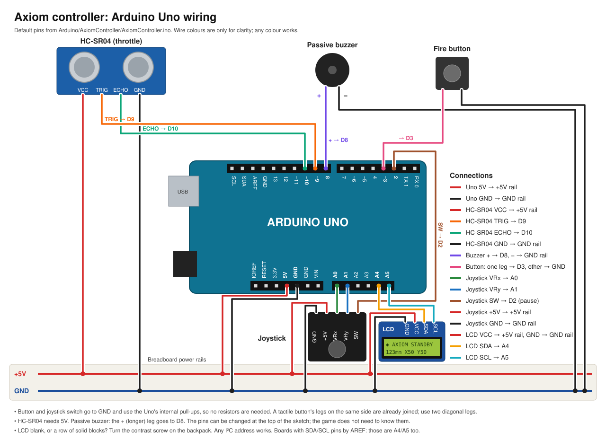

# Axiom controller (Arduino Uno)

Ultrasonic throttle, two-axis joystick, fire button, buzzer, a 16×2 cockpit LCD, runway lights and a
fan over USB serial.
Firmware: `AxiomController/AxiomController.ino`. Unity finds the controller on its own; keyboard
controls keep working whether or not it is connected.

## Wiring (default pins; change them at the top of the sketch)

To house it all, see the [enclosure build guide](enclosure/README.md).

| Part | Pin | Notes |
| --- | --- | --- |
| Joystick VRx / VRy | A0 / A1 | +5V and GND to the module |
| Joystick SW (push) | D2 → GND | Pauses the game. Optional |
| Fire button | D3 → GND | Uses the internal pull-up; no resistor needed |
| HC-SR04 TRIG / ECHO | D9 / D10 | VCC 5V, GND |
| Buzzer (passive) | D8 → GND | An active buzzer also works, at a fixed pitch |
| LCD (I²C backpack) SDA / SCL | A4 / A5 | VCC 5V, GND. Optional. SDA/SCL pins by AREF, if your board has them, are the same |
| 74HC595 DS / SH_CP / ST_CP | D11 / D13 / D12 | Runway LEDs and RGB underglow. Optional. See [wiring-outputs.svg](wiring-outputs.svg) |
| L293D EN1 | D5 (PWM) | Fan motor, powered by the kit's power module. Optional |

The throttle is the distance from the HC-SR04 to your hand or a sliding plate.
The default range is 60 mm (minimum throttle) to 300 mm (maximum).

## Upload

1. Arduino IDE → Board: **Arduino Uno**, select its port, upload the sketch.
2. Optional check: Serial Monitor at **115200** baud shows lines like `AX,512,508,176,0,0*0E`.
3. **Close the Serial Monitor before starting the game.** Only one program can use the port, and
   the game reports the port as "in use" until the monitor is closed.

## Protocol v1

ASCII lines, newline-terminated, 115200 baud. `HH` is the XOR of every character before `*`, as
two hex digits. Lines that fail the checksum, field count or ranges are ignored.

| Direction | Message | Fields |
| --- | --- | --- |
| Controller → PC, every 20 ms | `AX,x,y,mm,fire,stick*HH` | x, y: 0–1023 · mm: distance, or -1 for no echo · fire, stick: 0/1 (debounced) |
| PC → controller | `BZ,hz,ms*HH` | Buzzer tone (31 Hz and up, up to 2000 ms) |
| PC → controller | `LT,row,text*HH` | One LCD row (0 or 1), padded to 16. `\0`–`\7` custom glyphs, `\>` `\<` arrows, `\#` block |
| PC → controller | `LF,lights,fan*HH` | lights: bits 0–4 runway LEDs (0 nearest the sensor), 5–7 underglow R/G/B · fan: 0–255. The fan stops after 1 s without one |

## Behavior in the game

- **Connecting:** the game scans serial ports and connects to the first one that sends valid
  `AX` packets within 3 s. The Uno resets when the port opens, so the first connection takes about 2 s.
  The last good port is tried first.
- **Unplugging:** if packets stop for 1 s, the controller counts as disconnected. A run in progress
  pauses with a notice, and you can resume on the keyboard. Replugging reconnects automatically.
- **Sonar dropouts:** brief gaps hold the last throttle value. After 0.5 s without an echo, the HUD
  shows "THROTTLE SENSOR: NO SIGNAL", the buzzer sounds, and the throttle eases to cruise.
- **Buzzer:** cues for shield hits, entering a throttle zone, and a lost sensor, each paired with an
  on-screen cue. Turn it off with **Options → Controller buzzer**.
- **Proximity:** when the ship's current path will hit scenery within 1.2 s, the buzzer beeps faster
  as it gets closer, like a parking sensor, then holds a solid tone. A PROXIMITY tag on the HUD (and
  the LCD) pulses in time. Targets don't count.

## Runway lights and fan

- **Runway lights:** 5 LEDs beside the throttle slot, each covering a fifth of the lever's travel.
  Before a throttle zone its recommended band blinks; inside it the band lights steadily and, while
  the lever is outside it, a light runs from the lever toward the band. Without the game, the LED
  beside the lever lights up, a quick check that they line up. White keeps the console monochrome,
  but any colour works.
- **Placing them:** push the lever to each end stop and mark the lid beside the knob's centre. Divide
  the distance into five equal parts and drill a 5 mm hole at the middle of each, just past the
  tunnel's divider wall (the case blueprint shows the nominal spots). LED 1 is the one nearest the sensor.
- **Underglow:** the RGB LED under the console flashes red on hits and magenta on kills.
- **Fan:** blows on your hands in proportion to speed: still at minimum, full at maximum, with a gust
  through each closing iris. Mount the motor outside the case at the back, facing you, inside a guard
  (drilled card, mesh or a cut bottle), with its wires through a small hole. Turn it off with
  **Options → Controller fan**. If it stalls at low speed, raise `FAN_MIN_DUTY` in the sketch.
- **Power:** the fan runs from the kit's power module, not the Uno. A motor starting on USB power can
  reset the Uno, which the game treats as an unplug.

## Cockpit display

The LCD needs no library; the sketch finds its I²C address. If it is blank or shows solid blocks,
turn the contrast screw on the backpack.

- **Standby** (no game running): a spinning octahedron and a live self-test: distance, stick X/Y
  (0–99) and F/P when fire or the stick switch is pressed. Handy for aligning the throttle track.
- **Menus:** the selected item. **Calibration:** the step and the reading it needs.
- **Flight:** speed bar and speed; shield, targets and time below. In a throttle zone the bar marks the
  recommended band and the bottom row says LOWER / RAISE / HOLD. Hits and a lost sensor flash here too.
- **Pause** mirrors the menu; **results** page through time, par, targets, accuracy and shield.

The game draws every screen (`CockpitDisplay.cs`), so layouts change without reflashing. The sketch
only stores the 8 custom glyphs and falls back to standby 3 s after the game stops sending.

## Calibrating

**Options → Calibrate controller** (from the main menu or the pause menu). Press FIRE on the controller,
or the on-screen CAPTURE button, at each step:

1. Let go of the stick (records its resting centre).
2. Slide the throttle to its minimum.
3. Slide it to its maximum. Either end can be the nearer one; they must be at least 30 mm apart.
4. Check the live dot and bar, flip the invert switches if an axis runs backwards, then **Save**.

Saved values override the defaults in `ControllerCalibration.cs`; Cancel keeps the previous ones.
