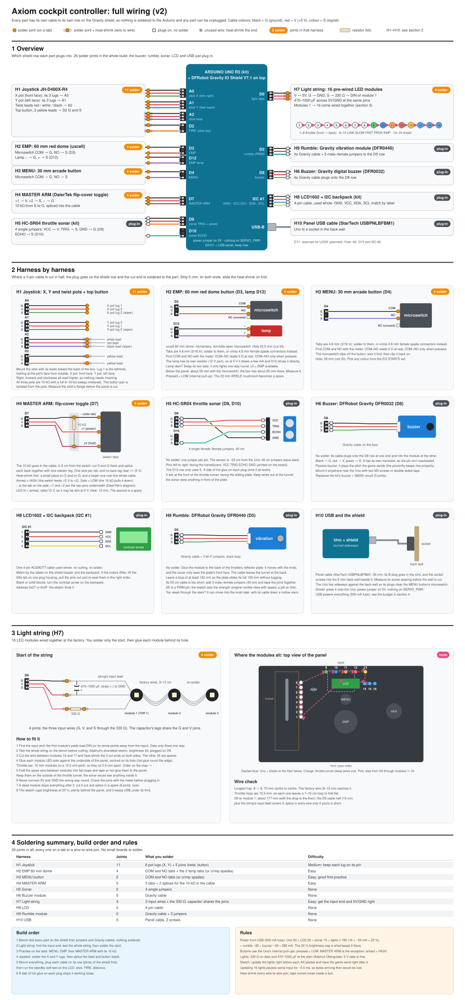

# Axiom cockpit controller (v2)

One sloped box (compact preset 420 × 245 mm): throttle lever with 8 lights on the left, analog stick
with FIRE on top on the right, LCD, shield lights and LINK/SLOW/FAST/PROX/EMP warning lights in the
middle, a 60 mm red dome EMP button (with its own lamp), a MENU button and a flip-cover MASTER ARM switch.
The 16 lights are one pre-wired LED string, and the buzzer and rumble are plug-in modules, so the whole build
has 24 solder joints.

- 3D model: [axiom_cockpit.blend](axiom_cockpit.blend) (built by [make_cockpit.py](make_cockpit.py); `--roomy` for 500 × 280)
- Top panel: [panel_cut.svg](panel_cut.svg) (1:1 laser-cut outline) and [panel_template.pdf](panel_template.pdf)
  (1:1 mock-up guide on 4 Letter pages; also `.html`/`.svg`), written by the same script (`-- --panel` for only these)
- Wiring: [wiring-cockpit.svg](wiring-cockpit.svg) (built by [make_wiring.py](make_wiring.py)): overview, every harness
  terminal by terminal, where the lights go, and a soldering summary

## In the game

Decided 2026-09-30. Only the parts marked ✓ are in the game so far; the rest is for M4.

| Control | In flight | In menus |
| --- | --- | --- |
| Stick | Steer ✓ | Move the selection |
| FIRE (stick top) | Hold to fire ✓ | Capture in calibration ✓ |
| Throttle lever | Push forward = faster, cruise detent in the middle ✓ | |
| EMP (60 mm dome) | Once per run: destroys all enemies near the ship. Its lamp is lit while the EMP is unused | Confirm; **LAUNCH** once armed; continue/retry on results |
| MENU | Pause ✓ | Back |
| MASTER ARM | Flipping to SAFE pauses | A run waits until armed: flip ARM (the cockpit lights wake), then EMP to launch |
| Twist | Undecided: barrel roll or visual banking | |

Without the cockpit, runs start as now and the keyboard gets an EMP key.

- **Rumble:** engine rumble that grows with speed, plus a jolt when the shield is hit.
- **Buzzer and LCD:** as on the kit controller (hits, zones, lost sensor, proximity beeps; [../README.md](../README.md)).
- **Throttle lights (8):** a dot where the lever is. Before and in a zone, its recommended range lights up and a
  running light leads the lever toward it.
- **Shield (3, blue):** one per segment.
- **Warning lights,** each behind a printed label so nothing relies on colour alone: **LINK** connected to the
  game, **SLOW / FAST** a zone coming up or active, **PROX** blinks with the proximity beeps, **EMP** still available.
- **Preflight check** (closes M4): arm MASTER ARM, match the throttle to the lit light, follow the stick prompts
  on the LCD, press FIRE.

Rejected, so not to be revived: ghost-hand best-run light, underglow, fan, target tally, lit buttons, a second
button (HUD toggle), throttle-sensor light, fire-button glow, START light, UltraStik.

## Parts

Prices are approximate (October 2026).

**Have** (everything, as of 2026-10-20)

| Part | Notes |
| --- | --- |
| SaiDian JH-D400X-R4 joystick with button ([Amazon](https://www.amazon.com/dp/B08CGYGMJL)) | X and Y pots have bare lugs; the 5 leads are the twist pot (red/white/black) and the top button (2 yellow) |
| uxcell 60 mm red dome arcade button ([Amazon](https://www.amazon.com/dp/B07XMCL5YW)) | EMP. Momentary microswitch, 23.5 mm hole; its 12 V lamp has its own resistor |
| EG STARTS 30 mm Happ-style buttons, 6 colours ([Amazon](https://www.amazon.com/dp/B07GBSJX2H)) | MENU + spares; 28 mm hole |
| DaierTek lit toggle with flip cover, 2-pack ([Amazon](https://www.amazon.com/dp/B07T6XJF1T)) | MASTER ARM + a spare |
| DFRobot Gravity IO Expansion Shield V7.1 ([Amazon](https://www.amazon.com/dp/B00G3IKO68)) | GND / 5V / signal for every pin |
| DFRobot Gravity digital buzzer DFR0032 and vibration module DFR0440 ([Mouser](https://www.mouser.com/ProductDetail/DFRobot/DFR0440?qs=lqAf/iVYw9hBeDOJTobUyg%3D%3D)) | Buzzer passive; rumble cable 30 cm (extend with 3 M–F jumpers) |
| ACEBOTT female–female Dupont cables, 14 × 3-pin, 5 × 4-pin ([Amazon](https://www.amazon.com/dp/B0DTKDKF5C)) | Cut in half for the soldered parts; one 4-pin for the LCD |
| EDGELEC jumper wires, 40 cm, assorted F–F / M–F / M–M ([Amazon](https://www.amazon.com/dp/B07GD2PGY4)) | F–F: HC-SR04. M–F: rumble extension. M–M: bench tests |
| StarTech USBPNLBFBM1 panel-mount USB-B cable, 30 cm ([Amazon](https://www.amazon.com/dp/B002M8VBIS)) | Socket screws into the back wall |
| Bates heat-shrink kit, capacitor set (470–1000 µF, 10 V+ for the lights), soldering gear, multimeter | |
| APIELE 22 mm mushroom | Spare, replaced by the 60 mm dome |
| From the SunFounder kit: Uno R3, HC-SR04, LCD1602 (I2C), resistors (330 Ω, 10 kΩ) | |
| TOPXCDZ pre-wired WS2812B LED modules, 10 cm wire, 2 strings of 50 ([Amazon](https://www.amazon.com/dp/B0B6NVQGJF)) | Arrived 2026-10-20. 16 used. Must be **5 V**, not 12 V: check the label |

Optional: 4.8 mm female spade connectors and a crimper, if you'd rather crimp than solder the button tabs.

**Enclosure** (order after the cardboard mock-up)

| Qty | Part | Link | ≈ | Notes |
| --- | --- | --- | --- | --- |
| 1 | Top panel, 3 mm black acrylic, laser cut | [SendCutSend](https://sendcutsend.com/materials/acrylic/) | $40–60 | `panel_cut.svg`, after the mock-up |
| 1 | Body, 6 mm Baltic birch plywood, laser cut | [SendCutSend](https://sendcutsend.com/materials/baltic-birch-plywood/) | $40–60 | Sides, front, back, bottom |
| 1 | Rubber feet, wood glue, M3 screws, adhesive leatherette for the palm rest | Any | $15 | |

## Wiring checked against the manufacturers

| Part | Our wiring | Source | Result |
| --- | --- | --- | --- |
| Arduino Uno R3 | A4/A5 = I2C; pins ≤ 20 mA; USB ≤ 500 mA | [Arduino store](https://store-usa.arduino.cc/products/arduino-uno-rev3) | OK: no pin drives a load directly (the buzzer and rumble modules switch their own current) |
| Gravity IO shield V7.1 | Every part on its own G/V/S row, LCD on I2C #1 | [DFRobot wiki](https://wiki.dfrobot.com/IO_Expansion_Shield_for_Arduino_V7_SKU_DFR0265) | OK. **Power jumper on 5V**; SERVO_PWR only feeds D0–D13, leave it empty |
| JH-D400X-R4 | X pot lugs to A0, Y pot lugs to A1, twist leads to A2 (G/V/S each), button pair to D2 G/S | Seller's lead colours + meter | **Metered**: all three pots 10 kΩ, full sweep, wiper on the middle lug / black lead; button isolated. Lug order: wiring sheet, H1. Twist deferred: leads left long and taped until it has a game use |
| HC-SR04 | VCC/TRIG/GND on D9, ECHO on D10, single jumpers | [Datasheet](https://cdn.sparkfun.com/datasheets/Sensors/Proximity/HCSR04.pdf) | OK: 5 V part, 5 V echo |
| LCD1602 I2C backpack | GND/VCC/SDA/SCL to I2C #1 | Kit module (PCF8574) | OK: address 0x27 or 0x3F |
| Pre-wired LED string | 330 Ω on data, 470–1000 µF at the start, input end first | [Module specs](https://www.ledlightinghut.com/pre-soldered-ws2812b-sk6812-smart-circle-pcb-string.html), [Überguide](https://learn.adafruit.com/adafruit-neopixel-uberguide/best-practices) | OK: WS2812B or SK6812, 5 V, GRB, up to ~55 mA each at full white |
| Gravity buzzer DFR0032 | Its cable on D8 | [DFRobot](https://www.dfrobot.com/product-84.html) | OK: passive (plays the sent pitch), 3.3–5 V, cable included |
| Gravity vibration DFR0440 | Its cable + 3 M–F jumpers on D5 (PWM) | [DFRobot](https://www.dfrobot.com/product-1542.html) | OK: 5 V, on/off or PWM strength, 30 × 22 mm, 30 cm cable included |
| MASTER ARM (DaierTek) | +1 to 5V, +2 to D7, − (side tab) to GND, 10 kΩ +2→− | [DaierTek](https://daiertek.net/led-toggle-switch-12v/) | OK: 12 mm hole. **Reads HIGH when armed**. 12 V LED: may be dim at 5 V |
| EMP: uxcell 60 mm dome | Microswitch COM to GND, NO to D3; lamp + to D12 S, − to D12 G | [Listing](https://www.amazon.com/uxcell-Button-Illuminated-Switch-Arcade/dp/B07XYV5NNP) | OK: momentary, 1 NO, 23.5 mm hole. The lamp's own resistor keeps it to a few mA at 5 V |
| 30 mm buttons | Microswitch COM to GND, NO to the pin | [EG STARTS listing](https://www.amazon.com/dp/B07GBSJX2H) | OK: **28 mm hole**, not 30 |
| Panel USB (StarTech USBPNLBFBM1) | Uno to the back wall | [Datasheet](https://media.startech.com/cms/pdfs/usbpnlbfbm1_datasheet.pdf) | OK: B socket to B plug, 30 cm, screw mount. Hole spacing not published: **measure** before the back wall is cut |

**Power from USB (500 mA fuse):** Uno 50 + LCD 25 + HC-SR04 15 + lights ≤ 180 (16 × ~55 mA at a 20 %
brightness cap) + rumble ~80 + buzzer ~30 ≈ 380 mA. The sketch must cap brightness: all 16 at full white
would draw ~880 mA on their own.

**Fit (checked in the model):** the throttle stem is a 6 mm rod in the 8 mm slot; the rumble module sits on
the back of the reflector plate, where the sonar can't see it; the Uno lies sideways against the back wall
so its plugs clear the MENU microswitch, with the USB socket beside it.

## Sketch (v2)

[AxiomCockpit/AxiomCockpit.ino](../AxiomCockpit/AxiomCockpit.ino). The v1 sketch stays for the kit wiring
(its pins differ). Protocol v2 extends v1, so the game works with either:

| Direction | Message | Fields |
| --- | --- | --- |
| Controller → PC, every 20 ms | `AX,x,y,mm,fire,menu,twist,emp,arm*HH` | The first six as in v1 (MENU in the pause slot); twist 0–1023, emp/arm 0/1 |
| PC → controller | `RM,level,ms*HH` | Rumble 0–255. `ms` 0 = steady level, dropped 1.5 s after the last one; `ms` > 0 = a pulse |
| PC → controller | `LA,mode*HH` | EMP dome lamp: 0 off, 1 on, 2 blink |

`BZ` and `LT` are unchanged. Buzzer loudness: `BUZZER_VOLUME` at the top of the sketch (% of each cycle the
buzzer is driven; 50 = full, 0 = mute, default 10). A0 X (right = high), A1 Y (forward = high), A2 twist (clockwise = high).
Pull-ups on D2 FIRE, D3 EMP, D4 MENU: pressed = LOW. D7 MASTER ARM: HIGH = armed.

Each pass of `loop()` reads the clock once, and commands and the self-test use that same time, so a command
arriving mid-pass can't look like the game went silent.

**Standby self-test** (no game running): row 1 shows the distance, X, Y and twist (0–99); row 0 shows
F E M A for FIRE, EMP, MENU and armed. Each press clicks, MASTER ARM chirps up/down, **holding EMP runs the
rumble**, and the EMP lamp stays lit. **Pressing EMP plays a 2.2 s demo:** charge (lights, lamp flicker, rising
pitch), a white shockwave down the string with a low boom and full rumble, then crackling sparks fading out;
the lamp relights at the end.

**Lights (D6)**, needs the Adafruit NeoPixel library: so far only a standby test. A dot runs along the
string in red, then green, then blue, at the 20 % brightness cap; off while the game runs. Every frame is
also dimmed if its estimated draw is over `LIGHT_BUDGET_MA` (180 mA). `LIGHT_COUNT` is 50
to test a whole uncut string; set it to 16 once the string is cut. No game command yet. `show()` runs right
before each `AX` packet, and the game should send right after receiving one: `show()` pauses interrupts
(~0.5 ms for 16), and serial bytes arriving during it are lost.

## Bench test (before soldering)

1. Shield on the Uno, power jumper on **5V**. Upload `AxiomCockpit` (board: Arduino Uno).
2. Plug on the LCD (I2C #1), the buzzer (D8), the rumble module (D5) and the sonar (D9/D10 jumpers).
3. **D7 floats without the switch:** put a jumper from D7 S to D7 G, or the A flickers.
4. Buttons: touch a jumper between a row's S and G pins (D2 FIRE, D3 EMP, D4 MENU), or wire the real
   microswitch's COM to G and NO to S. EMP lamp: + to D12 S, − to D12 G. Joystick: a clip lead per lug.
5. Check each reading on the LCD. Hold D3 S to G to feel the rumble.

**Upload with Unity out of Play Mode** and the Serial Monitor closed: the game holds COM3, and the upload
fails with "Access is denied".

## Build progress

- [x] Bench test of the sketch with jumpers (2026-10-18)
- [x] MENU (D4), EMP (D3) and the EMP lamp (D12): connected (taped), working
- [x] MASTER ARM (D7, with the 10 kΩ): connected (taped), working
- [x] Joystick: X (A0), Y (A1) and FIRE (D2): connected (taped), working (2026-10-20)
- [ ] Twist (A2): deferred, see above
- [x] Sonar (D9/D10 jumpers): working (2026-10-20)
- [x] Light string (D6): string test passed on the breadboard (2026-10-20)
- [ ] Enclosure: cardboard mock-up from the template and measurements (below), then final cut files, order
- [ ] Solder every harness (all 24 joints) while mounting in the enclosure; until then, joints are taped

**Joystick tips:** cut the A0 and A1 cables long (about 25 cm on the plug side), since the lugs have no leads
and the stick sits about 20 cm from the Uno; a short harness can be extended with M–F jumpers later. The
leads are about 28–30 AWG, too thin for most strippers: melt 3–4 mm of insulation back with the iron (or roll
it under a craft knife), check no strands are cut, tin at once, wrap around the tinned cable wire, solder,
heat-shrink. Tin the pot lugs first and join in 2–3 s. A dab of hot glue where the leads leave the stick
body relieves strain. Meter each pot cable before plugging in: G–V a fixed ~10 kΩ (never 0), G–S changes
with tilt.

## Cardboard mock-up

1. Print `panel_template.pdf` at **100 % / Actual size**; check the 100 mm bar with a ruler. Overlap the shaded
   strips so the grid lines up, tape, and glue onto stiff cardboard (a box side).
2. Cut the solid outlines (holes, slot, windows). Dashed lines are part footprints, not cuts.
3. Make a box for it: 420 × 245 mm, 60 mm tall at the front, 94 mm at the back (8° slope).
4. Mount the real parts and check: every body fits underneath (EMP dome needs ~60 mm), nothing collides,
   hand reach, and the throttle travel. Note anything that should move.
5. **Measure** with calipers or a ruler and send the numbers: joystick top plate and its 4 screw holes
   (spacing), the hole each part actually needs (EMP, MENU, MASTER ARM, LCD window and its screw holes), the
   USB socket's screw spacing, and the light modules' diameter.

Then the cut file is updated from the measurements and the body (6 mm plywood) cut file is added.

## Check when the parts arrive

Done 2026-10-18: joystick wires metered, EMP springs back with NO closing, MASTER ARM's − tab found,
EMP lamp has its own resistor.

1. **Light string:** each end has a 3-pin plug (usually red 5V, green data, white GND) plus a bare red/white
   power-injection pair; insulate that pair's ends separately, since it is live. Find the input end (first
   module's pads read DIN, or the arrows point away from it), run the standby test on the whole string (every
   module shows red, green, then blue) before cutting it after module 16.
2. **EMP dome:** check the body plus microswitch is under about 60 mm below the panel (the box has about
   65 mm there).
3. **Rumble:** with the module taped to the plate, check you can feel it at the knob. If not, it moves into
   the knob with its cable down a hollow stem.
4. **Before ordering the panel:** measure the joystick's flange and screw spacing, and the button and switch
   bodies, and the USB socket's screw spacing. The model's openings are from listings (stick 40 mm hole,
   32.5 mm screw square, dome 24 mm).
