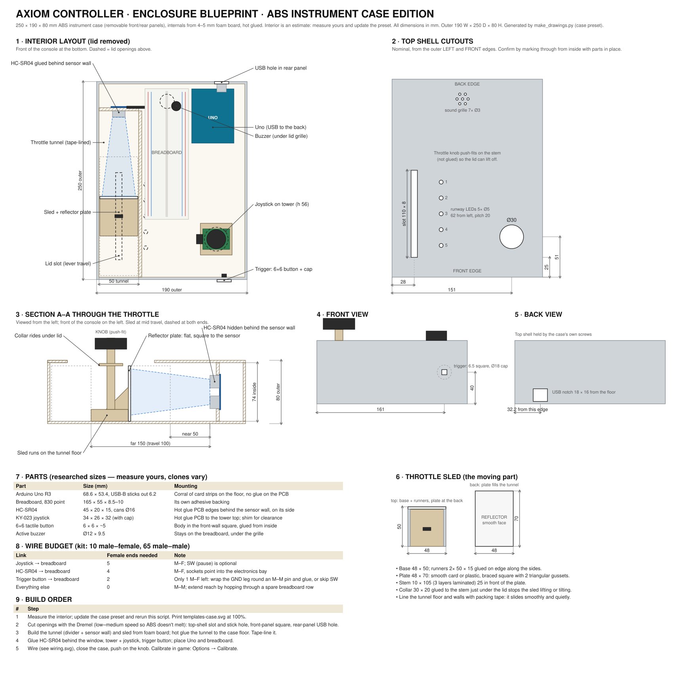

# Axiom controller enclosure

A desk console: throttle lever on the left, thumbstick on the right, fire trigger on the front face.
The recommended build uses an off-the-shelf ABS case cut with a Dremel. An all-cardboard version
is kept as a fallback.

| Edition | Drawings | Outer size |
| --- | --- | --- |
| **ABS instrument case** (recommended) | [blueprint-case.svg](blueprint-case.svg) · [templates-case.svg](templates-case.svg) | 250 × 190 × 80 mm |
| Cardboard / foam board | [blueprint-cardboard.svg](blueprint-cardboard.svg) · [templates-cardboard.svg](templates-cardboard.svg) | 204 × 258 × 68 mm |

Templates are 1:1: **print at 100% / "actual size"** and check the 50 mm scale bar.
[make_drawings.py](make_drawings.py) generates everything from the dimensions in its presets.

## The case

Buy a **250 × 190 × 80 mm ABS "instrument" project case**: a two-part shell with **removable front
and rear panels**. It's sold as, for example, the
[uxcell 250 × 190 × 80 mm project box](https://www.amazon.com/uxcell-Plastic-Project-Enclosure-Electronic/dp/B014GN1I70)
or the [Wiltronics CA0082](https://www.wiltronics.com.au/product/57093/abs-instrument-case/). Why this one:

- **It fits.** The throttle tunnel needs about 225 mm of depth with 50 mm of width beside the breadboard and Uno;
  this is the smallest common case that holds all of that side by side.
- **Flat, separate panels.** The trigger and USB openings go into loose front and rear panels, so you
  can cut them flat on the bench.
- **ABS cuts cleanly** with a Dremel, unlike polypropylene pencil boxes, which melt and tear.
- The shell screws shut, so it survives being handled at a demo.

Rejected: Hammond 1591 cases (the largest is 221 × 150 mm, too short), the Sterilite pencil box
(219 × 146 × 64 mm: too narrow, and floppy polypropylene), and 250 × 200 × 100 mm IP65 junction
boxes (these work, but they're 100 mm tall with a deep gasketed lid; use one only if nothing else is available).

## When it arrives: measure, then regenerate

The retailer doesn't publish interior dimensions, so the `case` preset assumes
**184 × 244 × 74 mm** inside, the outer size minus about 3 mm walls. Before cutting:

1. Measure the inside width, the depth between the front and rear panels, and the height with the case closed.
2. Note anything in the way, such as corner screw posts, PCB guide ribs or vent slots.
3. Put your numbers in the `case` preset (`W_IN`, `D_IN`, `H_IN`, `T`) and run `python make_drawings.py case`.
   The layout, throttle travel and templates all update.

The design leaves margin: the sensor pocket at the back has about 30 mm spare, so a slightly shallower case still fits.

## How the throttle works

The HC-SR04 is glued **behind** a foam-board wall at the back of an enclosed tunnel, on its side,
with its two transducer cans through a 17 × 43 mm window, so it can't be seen. A sled carries a flat
**reflector plate** that fills the tunnel, so the sensor only ever sees that plate. Face the plate with
smooth card or plastic and keep it square: the datasheet wants a flat, smooth target.

- **Track:** the tunnel's floor and walls (packing-tape lined), plus a stem through the top-shell slot
  with a collar riding under the shell. That keeps the sled square and stops it lifting.
- **Travel:** the slot ends are the stops. The plate moves 50 → 150 mm from the sensor, 100 mm of travel.
- **Calibrate** after building: Options → Calibrate controller.

## Cutting ABS with a Dremel

- **Holes:** drill a pilot, then open up with a sanding drum or a ~6 mm cutter. Use a step bit if you have one.
- **Slot:** chain-drill both ends, join them with a cutting disc, then file straight.
- **Speed:** low to medium (setting 4–6). At high speed ABS melts and gums up the bit, so take short passes.
- **Marking:** use masking tape on the case, tape the printed template on top, and cut through both.
  Where a position depends on a part, such as the USB jack or the grille over the buzzer, place the part
  and mark through from inside instead of trusting the nominal number.
- **Safety:** wear glasses, and clamp the panel rather than holding it.

## Build order (case)

1. Measure, update the preset, regenerate and print the templates.
2. Cut the openings: top-shell slot and Ø30 stick hole (plus optional grille), front-panel trigger
   square, rear-panel USB hole.
3. From 4–5 mm foam board, build the divider and sensor wall, then hot glue them to the case floor.
   Line the tunnel with packing tape.
4. Build the sled from the template parts. Dry-fit it with the stem through the slot and check it slides
   the full length without twisting. The knob push-fits (not glued), so the shell can still open.
5. Glue the HC-SR04 around its PCB edges behind the window, cans through, header pins toward the electronics.
6. Build the 56 mm joystick tower and glue the module on top. Dry-close the shell and tilt the stick fully in
   every direction; shim the tower if the cap catches.
7. Push the trigger button body into the front-panel square from inside, glue it from behind, and glue the
   Ø18 cap **to the actuator only**.
8. Place the Uno (USB jack at the rear hole) and breadboard, wire them using [../wiring.svg](../wiring.svg),
   close the case, then push on the knob. Calibrate in the game.

## Wiring notes

- **Female ends:** the kit has 10 male–female jumpers, but the joystick (5), HC-SR04 (4) and
  trigger (2) need 11. Wrap the trigger's GND leg tightly round a male–male pin and glue it, or leave the
  joystick's SW (pause) unconnected.
- **Reach:** to extend a jumper, plug it into a spare breadboard row and continue from that row.
- **Buzzer:** the kit's buzzer is **active**, so it has a fixed pitch. The game's cues still sound, all at
  about the same pitch.

## Researched dimensions

Clone modules vary by a millimetre or two; measure yours and adjust the presets.

| Part | Dimensions | Source |
| --- | --- | --- |
| Arduino Uno R3 | 68.6 × 53.4 mm; USB-B jack protrudes about 6 mm | [Arduino UNO R3 docs](https://docs.arduino.cc/hardware/uno-rev3), [Pololu](https://www.pololu.com/product/2191/specs) |
| 830-point breadboard | 165 × 55 × 8.5–10 mm | [Rapid](https://www.rapidonline.com/rapid-solderless-breadboard-eic-102-830-point-165-x-55-8-5mm-50-5441), [Pololu](https://www.pololu.com/product/352/specs) |
| HC-SR04 | 45 × 20 × 15 mm; 2 cm–4 m; 15° measuring angle; wants a flat, smooth target; ≥ 60 ms between pings | [Elecfreaks datasheet](https://cdn.sparkfun.com/datasheets/Sensors/Proximity/HCSR04.pdf) |
| KY-023 joystick | 34 × 26 × 32 mm (with cap), M3 holes | [Module datasheet](https://www.mantech.co.za/datasheets/products/KY-023-220909A.pdf), [Joy-IT](https://www.joy-it.net/en/products/COM-KY023JM) |
| Tactile button (kit "small") | 6 × 6 mm, about 4.3–5 mm tall | [SunFounder kit list](https://www.sunfounder.com/products/unor3-project-starter-kit), [ProtoSupplies](https://protosupplies.com/product/tactile-momentary-pushbutton-white-6mm/) |
| Buzzer (kit) | Active, about Ø12 mm | [SunFounder kit list](https://www.sunfounder.com/products/unor3-project-starter-kit), [SunFounder buzzer page](https://docs.sunfounder.com/projects/uno-mega-kit/en/latest/components/component_buzzer.html) |
| Case options | uxcell / Wiltronics 250 × 190 × 80 (removable panels); Hammond 1591 tops out at 190 × 111 / 221 × 150; Sterilite pencil box 8⅝ × 5¾ × 2½ in | [Wiltronics](https://www.wiltronics.com.au/product/57093/abs-instrument-case/), [Hammond 1591](https://www.hammfg.com/electronics/small-case/plastic/1591), [Sterilite](https://www.sterilite.com/product/small-pencil-box/) |

## Cardboard fallback

The cardboard edition builds the whole shell from 4 mm corrugated card (floor 204 × 258, front/back walls
204 × 60, sides 250 × 60, lid 204 × 258), with the same internals, a longer 120 mm throttle travel, and
a tape-hinged lid. See [blueprint-cardboard.svg](blueprint-cardboard.svg).
