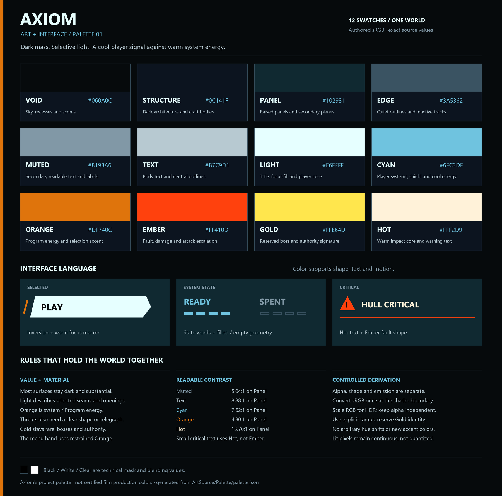

# Art palette

Axiom uses twelve authored colors across its world, effects and interface. Dark solid surfaces carry
most of the image; selective light gives them direction and scale. The player's cool signal contrasts
with warm Program/system energy. These are project authoring values in sRGB.

[Open the full-resolution PNG](images/art-palette.png) or [the scalable SVG](images/art-palette.svg).



## Source and scope

[`ArtSource/Palette/palette.json`](../ArtSource/Palette/palette.json) is the source of truth. Its generator
produces [`AxiomPalette.cs`](../Assets/Scripts/Presentation/AxiomPalette.cs),
[`Palette.uss`](../Assets/UI/Palette.uss), the two reference boards above, and the shader color-property
defaults listed in `shader_defaults`. Shader logic remains hand-authored; only those declared color
defaults are regenerated. Change the source and regenerate; do not maintain another list of nearly
matching RGB values in a script, stylesheet or shader default.

The constraint applies to authored color in the game: the Opening scene, shared UI, runtime-generated graphics,
shaders, materials, prefabs and serialized scene settings. Existing artwork should use these tokens or their defined derivatives. New
art uses the same palette from its source-generation step onward.

Reference images and earlier screenshots are
records, not current game assets to repaint. Archived UI-showcase captures retain their original colors
and should be identified as historical. The title's source model and font are geometry, not an independent
palette; the current title material supplies its colors. Numeric textures such as masks, normals and
depth are data, so their channel values are not checked as painted colors.

The rendered image is continuous. Lighting, transparency, anti-aliasing, fog and bloom create intermediate
pixel values. Constraining the source palette does **not** mean quantizing final screenshots into twelve
flat colors.

## Swatches

| Token | sRGB | Use |
| --- | --- | --- |
| Void | `#060A0C` | Sky/fog floor, deep recesses and scrims |
| Structure | `#0C141F` | Dark architecture, craft bodies and primary dark surfaces |
| Panel | `#102931` | Raised UI panels, secondary planes and subdued atmospheric mass |
| Edge | `#3A5362` | Quiet outlines, inactive tracks and nonessential structural detail |
| Muted | `#8198A6` | Secondary readable text, labels and subdued pale facets |
| Text | `#B7C9D1` | Main body text, neutral outlines and brighter material facets |
| Light | `#E6FFFF` | Title, focused button fill, important values and player-white core |
| Cyan | `#6FC3DF` | Player systems, shield, acquisition and cool energy |
| Orange | `#DF740C` | Program/system energy, standard hostile emission and selection accent |
| Ember | `#FF410D` | Fault, damage, hostile attack and elite escalation |
| Gold | `#FFE64D` | Reserved boss or exceptional authority signature |
| Hot | `#FFF2D9` | Warm impact core and high-priority warning text |

Black `#000000`, White `#FFFFFF` and transparent Clear are technical identities for masks, neutral
multipliers, empty data, shadows and blending. They are not an alternate undocumented grey ramp.

The menu hero's thin trefoil uses **Orange**. Its steady motion and restrained glow make it a system
ornament. A warm color alone does not mean that an object is hostile or shootable: live targets and
attacks also have distinct geometry, motion, brackets or spatial telegraphs. Decorative architecture
must not borrow an incoming-lock or damage animation just because it uses the same hue.

## Interface and state

| State or element | Treatment |
| --- | --- |
| Main text / primary value | Text, with Light for the strongest emphasis |
| Secondary label | Muted over a sufficiently dark surface |
| Selected button | Light fill, Void text and Orange slanted marker; preserve the existing inversion and position shift |
| Player data | Cyan with a label, number, gauge shape or other readable structure |
| Ready / successful | Light or Cyan with READY, a check or a filled segment; no green accent |
| Unavailable / spent | Muted or Edge with the actual state word or an empty/slashed shape |
| Disconnected / fault | An Ember indicator and explicit OFFLINE/fault text; keep the text contrast readable on its actual panel |
| Critical warning | Hot text with an Ember border, icon or angular damage mark |
| Enemy / incoming attack | Orange base, Ember escalation and a brief Hot core; motion and shape establish urgency |
| Score / ordinary completion | Light or Cyan; keep Gold rare |
| Boss | Gold plus a distinctive silhouette or label |

Color supports information rather than carrying it alone. The interface must still distinguish focus
from fault, filled from empty, and SAFE from SPENT when hue is hard to perceive. The same applies to
player/enemy silhouettes and attack direction. Preserve the original UI structure; palette work does
not require replacement menus or HUDs.

Computed opaque sRGB contrast against Panel `#102931` is 5.04:1 for Muted, 8.88:1 for Text, 14.54:1 for
Light, 7.62:1 for Cyan, 4.80:1 for Orange and 13.70:1 for Hot. Ember is only 4.35:1 on that surface: use
Hot for ordinary small warning text and Ember for the accompanying mark. These rounded values describe
the solid colors, not a guarantee for translucent text over a moving world. Check the actual background,
alpha, font weight and presentation mode.

The [W3C contrast guidance](https://www.w3.org/WAI/WCAG22/Understanding/contrast-minimum.html) supplies a
useful 4.5:1 benchmark for normal text; its [use-of-color guidance](https://www.w3.org/WAI/WCAG22/Understanding/use-of-color.html)
also supports retaining shape and text cues. The swatches alone do not establish accessibility compliance.

## Material and light hierarchy

Keep most surface area in Void, Structure and Panel. Brighter facets and selected seams describe mass,
depth and travel. An environment loses scale when every edge carries the same bright outline. Pale
mathematical constructs can still use Muted, Text and Light; the palette does not require making every
object almost black.

The player and its systems use Light/Cyan. Standard Program energy uses Orange, with Ember for
escalation and Gold reserved for a boss or exceptional authority. A warm-white impact can briefly reach
Hot. A target's brief hit flash uses Hot; its persistent body/emission retains its identity.

The Swept Dart source model uses a non-emissive **Light** hull with **Text** secondary facets.
**Void** recesses and a **Structure** shield carrier preserve local contrast; **Edge** describes
vent details, while **Cyan/Light** remains selective system emission. This white player finish uses
the existing palette and does not change the dark environment hierarchy.

Persistent scenery emission should leave visual room for instruments, the craft and brief urgent
effects. Compare **lit area, halo width and local contrast**, not only the brightest pixel. The title
must remain readable against its background throughout a menu transition. A narrow band with excessive
bloom can still dominate the entire composition.

Sky and fog use the cool dark ramp. Floor seams should establish perspective without becoming a flat
glowing checkerboard. Dust, construction, EMP, missiles, target brackets and glitch effects also derive
from these families; they do not get independent convenience colors.

### Current emission tuning

Base hues come from the JSON. Scalar intensities remain inspectable tuning in the material role map
(`AxiomPaletteTools`) and the relevant effects; they are not additional colors. These are current
starting values, not a promise that equal multipliers produce equal brightness across shaders:

| Material role | Base token | RGB multiplier |
| --- | --- | --- |
| Quiet orange seam / dim Program | Orange | 0.6 / 0.8 |
| Menu trefoil / bright orange seam / Program | Orange | 1.3 |
| Original floor / opening floor lines | Cyan | 1.8 / 0.8 |
| Player shot / hostile shot | Cyan / Ember | 2.0 |
| Cyan seam / boundary light column | Cyan / Light | 2.0 / 2.2 |
| Missile trail / construction edge / laser | Light / Cyan / Cyan | 2.4 / 2.5 / 3.2 |
| Dark warm material body / emission | Ember | 0.4 / 1.5 |

Transient EMP and portal effects animate their scalar brightness separately. Judge their area and
halo against the persistent scenery rather than treating this table as a universal brightness rank.
The palette migration removes the legacy daytime skybox, uses palette camera backgrounds and neutral
ambient illumination, and preserves light intensity. This is a consistent dark base, not the completed
layered atmospheric sky design.

## Color space, alpha and HDR

`AxiomPalette` is in the `GeometricFlight.Presentation` namespace. Its public `Color` fields are
initialized from exact sRGB `Color32` bytes. Use those tokens directly for UI Toolkit style colors and
other consumers that expect authored sRGB.

```csharp
label.style.color = AxiomPalette.Text;
panel.style.backgroundColor = AxiomPalette.WithAlpha(AxiomPalette.Void, 0.88f);
```

`WithAlpha(Color color, float alpha)` preserves RGB, including existing HDR values, and assigns the
supplied alpha. It does not scale brightness or silently clamp the value. Authors remain responsible
for choosing an appropriate opacity.

`ShaderColor(Color srgb, float intensity = 1f, float alpha = 1f)` is for **raw shader-color inputs**. It
converts sRGB to linear when `QualitySettings.activeColorSpace` is Linear, scales only RGB by intensity,
and sets alpha independently. In a Gamma project it leaves the RGB encoding unchanged before scaling.

```csharp
Color energy = AxiomPalette.ShaderColor(AxiomPalette.Cyan, intensity: 2f, alpha: 0.4f);
propertyBlock.SetVector("_Tint", energy); // A raw MaterialPropertyBlock shader input.
```

For a **Material** property, use the separate `MaterialColor(material, propertyName, srgb, intensity,
alpha)` helper with `Material.SetVector`. The helper accounts for the shader property's encoding:
plain Color and `[Gamma]` properties store sRGB and convert during GPU upload; `[HDR]` Color and raw
Vector properties store shader-space values. `SetVector` does not bypass a material property's upload
conversion. This distinction was verified by rendering plain/HDR/Gamma properties to a linear float
texture in Unity 6000.3; a double conversion made the first orange-band capture incorrectly red.

```csharp
material.SetVector("_BaseColor",
    AxiomPalette.MaterialColor(material, "_BaseColor", AxiomPalette.Orange, 1.3f));
```

Do not run `ShaderColor` on a color that is already linear, and do not apply it to UI styles. Unity
material/serialized color properties and shader APIs can have different conversion rules; follow the
actual consumer's contract. A raw shader vector and a conventional Inspector color property are not
interchangeable simply because both contain four floats. Converting twice makes dark colors too dark;
skipping a required conversion makes them too bright.

Current property-block and global paths use `SetVector` / `Shader.SetGlobalVector` with `ShaderColor`;
additive/exhaust vertex colors use that same conversion when they carry the hue themselves. UI Toolkit, IMGUI and authored
Inspector colors use the sRGB tokens directly. The target hit-flash `MaterialPropertyBlock.SetColor`
path likewise receives the sRGB token because that API handles its color conversion. A white vertex
gradient is an identity when the material already supplies the hue, as with a tinted missile trail;
do not multiply the color into both places.

HDR values above one are permitted. Emission strength is a scalar separate from hue; preserve alpha
when changing it. Do not use `color * intensity` indiscriminately when the operation would also scale
alpha. Tune brightness in the current camera, tone mapping and bloom, not from a generic multiplier
copied across unrelated effects.

Allowed derivatives are:

1. Alpha fades/transparency with the selected RGB preserved.
2. Neutral shading and scalar RGB emission/exposure.
3. Any swatch may darken toward Void or Structure. The neutral ramp may interpolate between its own
   entries; Cyan may brighten toward Light; Orange and Ember may mix or brighten toward Hot. Gold is
   reserved: ordinary colors never blend toward it. An actual Gold authority/boss effect may brighten
   toward Hot. Alpha crossfades between approved semantic states are allowed; their intermediate colors
   do not become new swatches. Family membership alone does not authorize arbitrary mixing.
4. Greyscale masks and numeric textures whose channels are data rather than an art-color choice.

Do not add an untracked hue through per-channel multipliers or a convenience gradient. Colored texture
art and generated artwork use the same swatches and documented ramps. Reflection, fog and lighting can
naturally mix permitted colors in the final image.

## CRT presentation

The optional CRT presentation retains curvature, scanlines, grain, phosphor glow and the interface-on-
the-tube treatment. Those effects must preserve the palette's identities. Arbitrary hue rotation,
rainbow channel splitting or a colored grade that turns routine Orange into boss Gold undermines the
shared language. Use palette-derived fringing/echo colors and neutral grading controls.

The current runtime retains exposure, contrast, saturation and the CRT texture/glow controls while
neutralizing hue shift, color filter and white-balance temperature/tint. Legacy serialized fields remain
for compatibility; they are not permission to reintroduce new colors through the presentation grade.

Inspect essential text and world effects in both presentation modes. A band that is restrained normally
can become dominant through the CRT glow; a correct swatch does not excuse a poor value balance. This
presentation option is separate from flight handling.

## Authoring and checks

1. Choose the semantic token before editing a color. If an existing role fits, reuse it.
2. If the palette itself must change, edit `palette.json` and regenerate from the repository root:

   ```text
   python Axiom/ArtSource/Palette/generate_palette.py
   ```

3. Use `AxiomPalette` in C# and `--axiom-*` variables from `Palette.uss` in USS. The stylesheet provides
   the twelve swatches, Black/White, transparent, Void alpha 0.55/0.72/0.78/0.85/0.88/0.95/0.97, Light
   alpha 0.5, and Cyan alpha 0.45/0.5. Example names: `--axiom-light`, `--axiom-void-88`, `--axiom-cyan-50`.
4. Update material assets and serialized scene/prefab colors through the Unity Editor, preserving asset
   GUIDs, intended opacity/intensity and unrelated properties. Color migration must not reset tuning.
5. Check generated exports without writing files:

   ```text
   python Axiom/ArtSource/Palette/check_palette.py
   ```

6. Inspect the menu, full rail HUD, arena, pause/options and opening in both presentation
   modes. Confirm warning text, target identity, focus and ready/spent feedback at their actual size.

The source guard runs the generator check and scans game/editor scripts and UI for independent literal
colors and unknown stylesheet tokens. It is a scoped authoring check, not a proof that arbitrary future
shader logic cannot introduce a hue.

The generator uses the standard library for C#, USS, shader defaults and SVG; Pillow enables PNG export.
It uses Segoe UI or DejaVu Sans for the raster board. `--check` compares generated outputs to their source; when
Pillow is unavailable it explicitly skips the PNG check. Shader checks ensure new materials begin with
the declared palette defaults; existing serialized overrides still need their own audit. The generator
does not inspect every serialized material, scene or runtime effect, and it does not prove that a shader
consumer uses the correct color space. Generated shader defaults use sRGB storage for plain Color and linear storage for HDR Color, matching
this Linear project. Changing project color space would require reviewing HDR exports; the runtime
helpers independently account for the active setting.

A scene/material audit should report the exact object/property and intended semantic mapping rather
than silently rounding everything to the nearest swatch. Treat greyscale vertex masks, shader numeric
constants and neutral multipliers as technical values; treat a hardcoded alert tint as authored color
even when it lives in C# rather than a material asset.

## Unity asset and scene audit

Use **Tools > Axiom > Palette > Audit Assets and Active Scene** in the Editor. It reports palette issues
without modifying assets. The audit checks authored material roles, profile settings, prefab color
overrides and the active loaded scene. It does not open other scenes; make each scene active and audit
it separately. This matters because Unity's `RenderSettings` belong to the active scene.

The implementation is [`AxiomPaletteTools`](../Assets/Editor/AxiomPaletteTools.cs) in the
`GeometricFlight.Editor` namespace. Its explicit APIs are available to controlled Editor workflows:

| API | Behavior |
| --- | --- |
| `ValidateAssets()` | Returns issue descriptions for authored materials, presentation profiles and prefabs; flags unmapped material roles |
| `ValidateScene(Scene)` | Returns issues for the active loaded scene, including its RenderSettings |
| `ValidatePrefab(GameObject)` | Returns issues for a supplied prefab root |
| `ApplyMaterialsAndSettings()` | Applies the configured material/profile mappings and marks changed assets dirty |
| `ApplyToScene(Scene)` | Applies to the active loaded scene and marks it dirty |
| `ApplyToPrefab(GameObject)` | Applies to a supplied prefab root, such as one loaded with `PrefabUtility.LoadPrefabContents` |

Validation returns a `string[]`; apply methods return the number of changed properties. Apply methods
require Edit Mode. They do not load scenes, save assets or silently discard pending edits: the caller
owns scene/prefab loading, validation and saving. Nothing runs on import. Inspect the resulting changes
and visual behavior before saving; retain all existing `.meta` files and asset GUIDs.

The generator check and Editor audit complement one another. Passing them establishes consistency with
their declared source/role mappings, not final visual quality or automatic coverage of an arbitrary new
shader. Add an intentional mapping when adding a material role, then verify its rendered appearance.
