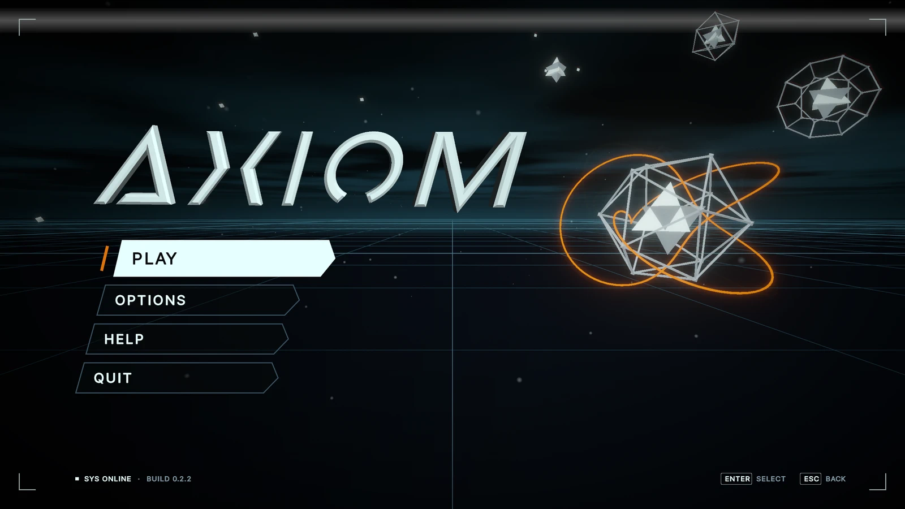

# Axiom

A flight shooter set in a world of light lines and dark glass. Flown on a custom Arduino cockpit, an Xbox controller
or the keyboard.

<h3 align="center">
  <a href="https://github.com/Ronno7/Axiom/releases/latest">Download 0.2.2</a> ·
  <a href="CHANGELOG.md">Changelog</a> ·
  <a href="https://ronno7.github.io/Axiom/">Showcase</a>
</h3>

0.2 is the playable opening: a menu, a tutorial rail and a first arena, in one continuous flight. Windows only. The
build isn't signed, so Windows may show a warning.

## Controls

| | Keyboard | Xbox controller |
| --- | --- | --- |
| Steer | WASD or arrows | Left stick |
| Twist | Z / C | LB / RB |
| Throttle, which stays where you leave it | Q / E | LT / RT |
| Boost | Hold E at full | Hold RT at full |
| Arm weapons | T | View |
| Guns | Space | A |
| Paint targets, release to fire missiles | Hold Shift | Hold B |
| EMP | R | Y |
| Look around, in the arena | | Right stick |
| Pause | Esc | Menu |

## Roadmap

| Version | |
| --- | --- |
| 0.1 | Prototype |
| **0.2** | **Playable opening** |
| 0.3 | One procedural rail and arena pair, with scoring |
| 0.4 | Vertical slice: final ship, real audio, finished UI |
| 0.5 | Alpha |
| 0.9 | Beta |
| 1.0 | Release |

## Directory

- [Cockpit](Axiom/Arduino/README.md): the hardware
- [Art palette](Axiom/Docs/ART_PALETTE.md)
- [Project board](https://github.com/users/Ronno7/projects/2) and [issues](https://github.com/Ronno7/Axiom/issues)

Made with Unity, Blender and Arduino.
