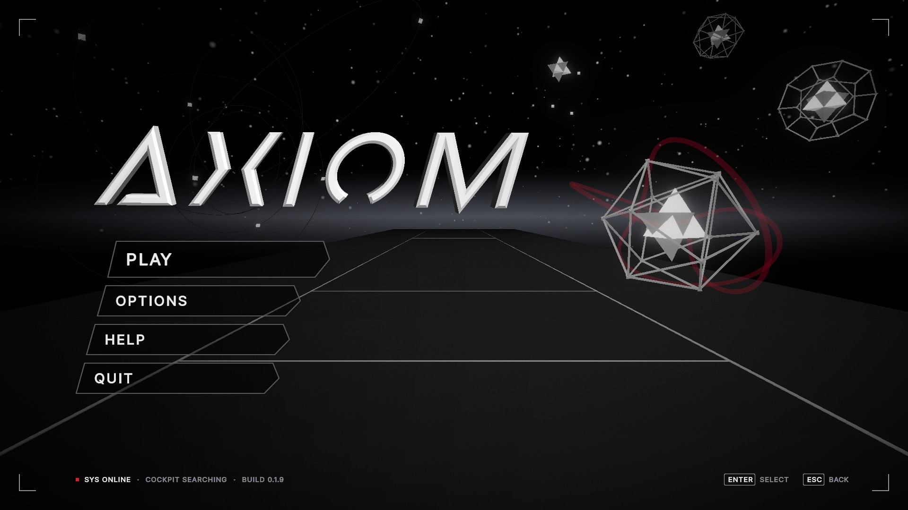

# Axiom

Geometric flight shooter, played on keyboard or on an Arduino cockpit controller. Currently an early prototype: one rough level where you fly a set course, adjust the throttle
for slow and fast sections, and shoot targets.

Version 0.1.9 (prototype). See the [changelog](CHANGELOG.md) for what's changed.

## Roadmap

- **Prototype (0.1.x):** decide whether this stays a rail shooter or opens up into free flight in 3D space,
  and get the cockpit built and working in game.
- **Vertical slice (0.2):** one level at final quality.
- **Alpha (0.5):** all features in.
- **Beta (0.9):** all content in, then polish and playtesting.
- **1.0:** a tested release build.

## Notes

How the systems work: [flight](Axiom/Docs/FLIGHT.md), [combat](Axiom/Docs/COMBAT.md), [UI](Axiom/Docs/UI.md).

Made with Unity (URP), Blender and Arduino.
