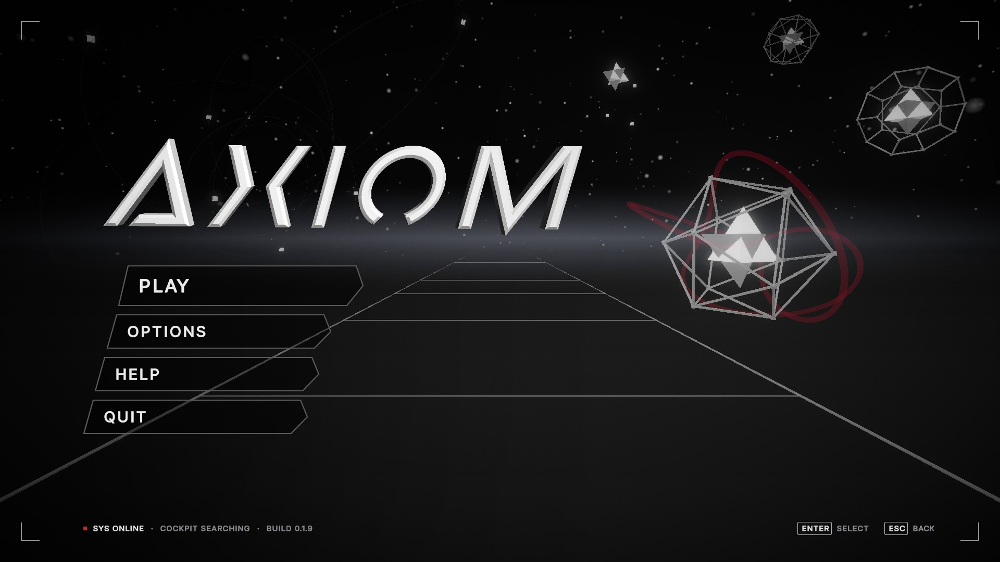

# Axiom

Flight shooter set in a world of light lines and dark glass, played on keyboard or on an Arduino cockpit
controller. Currently an early prototype. An authored opening flies from the menu into an enclosed passage as the
world builds itself around you, then runs through a tutorial rail into a first arena with free flight, lasers,
missiles and an EMP. The original rail and arena scenes remain as references.

Version 0.1.9 (prototype). See the [changelog](CHANGELOG.md) for what's changed.

## Roadmap

- **Prototype (0.1.x):** settle the game's form (free-flight arenas linked by rail runs is being tested), and get
  the cockpit built and working in game.
- **Playable opening (0.2):** the menu, tutorial rail and first arena as a tested prototype, with an overhauled UI,
  bug fixes, grid alignment and full controller support.
- **Procedural loop (0.3):** one procedural rail and arena pair built from the opening's pieces, with run scoring.
- **Vertical slice (0.4):** the opening and a procedural pair at near-final quality: final ship, real audio and
  finished UI.
- **Alpha (0.5):** all features in.
- **Beta (0.9):** all content in, then polish and playtesting.
- **1.0:** a tested release build.

## Notes

Development: [project table](https://github.com/users/Ronno7/projects/2),
[issues](https://github.com/Ronno7/Axiom/issues) and
[playable opening milestone](https://github.com/Ronno7/Axiom/milestone/1).
Issues summarize development intentions and progress, with short tasks and playtest updates.

**[UI showcase](https://ronno7.github.io/Axiom/):** an interactive tour of the interface, screen flow,
post-processing layers and the cockpit controller.

How the systems work: [flight](Axiom/Docs/FLIGHT.md), [combat](Axiom/Docs/COMBAT.md), [UI](Axiom/Docs/UI.md),
[art palette](Axiom/Docs/ART_PALETTE.md), [cockpit](Axiom/Arduino/cockpit/README.md). The opening in progress:
[shared entry study](Axiom/Docs/SHARED_ENTRY_STUDY.md); earlier experiments: [studies](Axiom/Docs/STUDIES.md).

Made with Unity (URP), Blender and Arduino.
