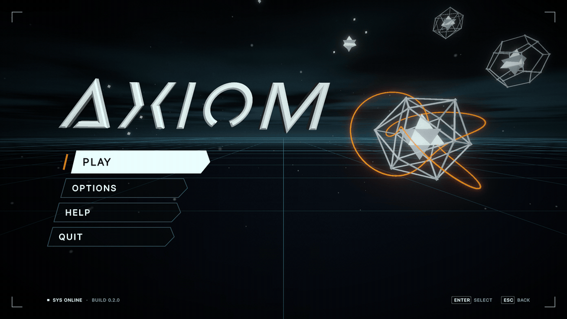

# Axiom

A flight shooter set in a world of light lines and dark glass, played on keyboard or on an Arduino cockpit
controller. The playable opening is one continuous flight: the menu gives way to a passage that builds itself around
you, a tutorial rail teaches the ship, and a first arena tests it with lasers, missiles and an EMP.

Version 0.2.0, the playable opening. See the [changelog](CHANGELOG.md) for what's changed.

**[UI showcase](https://ronno7.github.io/Axiom/):** an interactive tour of the interface, with the opening on video.

## Play

For Windows 64-bit. Download the zip from [Releases](https://github.com/Ronno7/Axiom/releases), unzip it and run
`Axiom.exe`. The build isn't signed, so Windows may warn you first.

| Key | Action |
| --- | --- |
| WASD or arrows | Steer |
| Z / C | Twist |
| Q / E | Lower or raise the throttle; hold E at full to boost |
| T | MASTER ARM: arm your weapons |
| Space (hold) | Fire guns |
| Shift (hold) | Paint targets; release to fire missiles |
| R | EMP |
| Esc | Pause |

To use the [cockpit controller](Axiom/Arduino/cockpit/README.md), plug it in and turn on **Options > Cockpit
controller (USB)**.

## Roadmap

- **Prototype (0.1.x):** settled the game's form, free flight arenas linked by rail runs, and got the cockpit working in game.
- **Playable opening (0.2):** the menu, tutorial rail and first arena as a desktop build, with an overhauled UI. Updates
  to follow: Xbox controls, mouse flight, grid alignment and bug fixes.
- **Procedural loop (0.3):** one procedural rail and arena pair built from the opening's pieces, with run scoring.
- **Vertical slice (0.4):** the opening and a procedural pair at near-final quality: final ship, real audio and
  finished UI.
- **Alpha (0.5):** all features in.
- **Beta (0.9):** all content in, then polish and playtesting.
- **1.0:** a tested release build.

## How it's built

- **Systems:** [the opening](Axiom/Docs/OPENING.md), [flight](Axiom/Docs/FLIGHT.md), [combat](Axiom/Docs/COMBAT.md),
  [UI](Axiom/Docs/UI.md), [art palette](Axiom/Docs/ART_PALETTE.md) and [earlier experiments](Axiom/Docs/STUDIES.md).
- **Hardware:** [cockpit controller](Axiom/Arduino/cockpit/README.md), with parts, wiring and firmware.
- **Next ship:** the [Swept Dart](Axiom/ArtSource/Ships/SweptDart/README.md), with renders and its import package. It isn't in the game yet.
- **Development:** [project table](https://github.com/users/Ronno7/projects/2) and [issues](https://github.com/Ronno7/Axiom/issues).

Made with Unity (URP), Blender and Arduino.
